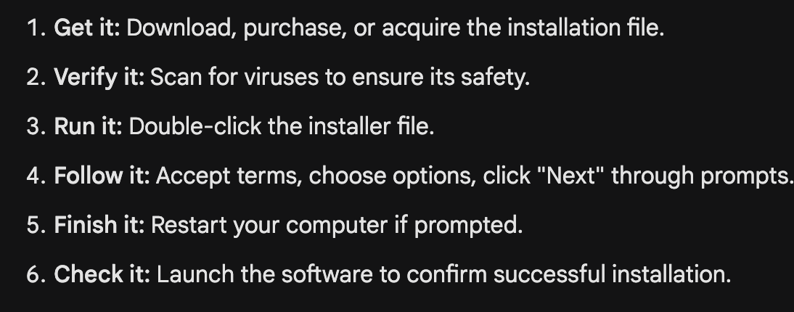
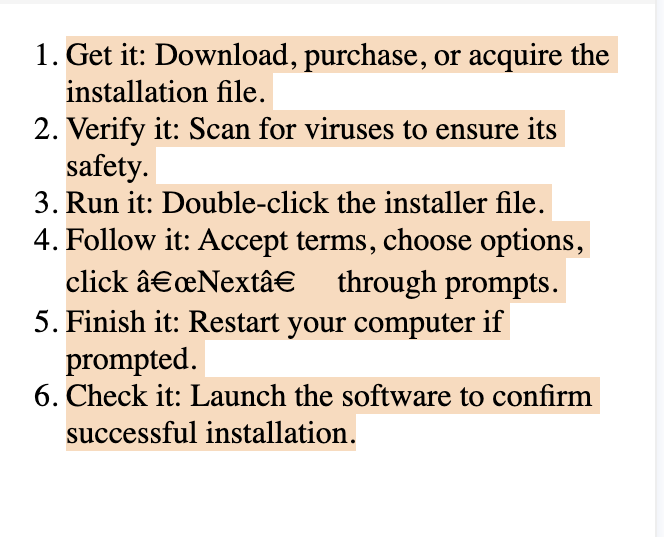

# Class 2 - Introduction to HTML Lists, Forms, and Tables

---

title: Agenda
description:
duration: 900
card_type: cue_card

---

# Agenda:

- HTML List
- Diffrent Types of Lists
- HTML Forms and its Attributes
- HTML Tables

---

title: List
description:
duration: 900
card_type: cue_card

---

## List

In HTML you can structure your content in a more readable and organized manner using lists

We have two kinds of Lists

1.  (Grocery List) (Unordered List)


2.  Check List for a blog(ordererd List)

 

<!-- Add images to show these lists -->

[ask the learners]
where order is important and where it is not.

### 1. Unordered List

Use `<ul>` tags for displaying a list with the help of symbols/shapes. In this case we're considering shapes.

#### Pseudocode

```html
<!DOCTYPE html>
<html>
<head>
    <title>List Examples</title>
</head>
<body>
    <ul type = "circle">
        <li>Banana</li>
        <li>Apple</li>
        <li>Strawberry</li>
    </ul
</body>
</html>
```

#### Output:


## 2. Ordered List

An ordered list is used to create a list of items that have a specific sequence or order. Each item in an ordered list is typically numbered, and the numbers usually increment in a sequential manner.
Each list item is defined with the `<li>` (list item) element, this will be more clear further in this article.

An ordered list can store content in two ways as well:

1. Non-alphabetically ordered
2. Alphabetically ordered

#### 2.1 Ordered List

In the following code you can clearly see that the output generated is not structured alphabetically but listed in an orderely fashion

#### Pseudocode

```html
<!DOCTYPE html>
<html>
  <head>
    <title>List Examples</title>
  </head>
  <body>
    <ol>
      <li>Get it: Download, purchase, or acquire the installation file.</li>
      <li>Verify it: Scan for viruses to ensure its safety.</li>
      <li>Run it: Double-click the installer file.</li>
      <li>Follow it: Accept terms, choose options, click “Next” through prompts.</li>
     <li>Finish it: Restart your computer if prompted. </li>
     <li>Check it: Launch the software to confirm successful installation. </li>
    </ol>
  </body>
</html>
```

#### Output:



### 2.2. Alphabetical Ordered List

In order to structure list in alphabetical fashion we can use `type = "A"` between `<ol>` tags

#### Pseudocode

```html
<!DOCTYPE html>
<html>
  <head>
    <title>Alphabetical Ordered List</title>
  </head>
  <body>
    <h1>Alphabetical Ordered List Example</h1>

    <ol type="A">
      <li>Banana</li>
      <li>Apple</li>
      <li>Strawberry</li>
    </ol>
  </body>
</html>
```

**Output:**


---

title: Tables in HTML
description:
duration: 900
card_type: cue_card

---

## Tables in HTML

We gnerally tables are used to organize and display data in a structured format. Tables consist of rows and columns, where each cell is capable of storing data in form of text.

But in-order to create tables in HTML one needs to be familiar with certain tags and attributes used such as:

1. `<table>`: tag is used to define the beginning of a table 2.`<td>`: tag represents a table cell that contains data
2. `<tr>`: tag represents a table row
3. `<th>` : tag represents a table header and is used to label columns or provide additional information about the data
4. `<thead>`: tag is used to group the header content in a table. It typically contains one or more `<tr>` elements with `<th>` elements inside.
5. `<tbody>`: tag groups the body content of the table.
6. `<caption>`: tag is used to provide a title or caption for the table. It is placed immediately after the opening `<table>` tag.
7. **border attribute**: is used to specify the thickness of the border around the table and its cells.

Before directly moving to writing code for tables , Show how a table looks like and what are each and every component

You can Take any example that you prefer , just make sure you make the learners aligned with what are all the parts of a table

You can take help of the example below-

Imagine you're putting together a detailed catalog for a library, and you want to organize information about each book including its title, author, genre, and availability. In this analogy:

1. **Catalog (HTML Table):** The catalog itself is like the HTML table. It's a systematic way of presenting information about various books.

2. **Table Header (HTML `<thead>`):** The table header is similar to the column headings in your catalog, labeling each column with crucial information like "Title," "Author," "Genre," and "Availability."
   You can use `<th>` to give proper headings

3. **Table Body (HTML `<tbody>`):** The body of the table, represented by the `<tbody>` element, is like the main section of your catalog where you list and organize the details of each book. It separates the header from the data, providing a clearer structure.

4. **Table Rows (HTML `<tr>`):** Each row in the table body corresponds to a specific book in your catalog. Each row neatly organizes the details of one book, similar to how a single entry in your library catalog contains information about a specific book.

5. **Table Data (HTML `<td>`):** The data cells within each row are like the specific details about each book – the title, author, genre, and availability. Each cell holds a piece of information just like your catalog cells hold details about each book.

6. **Table Caption (HTML `<caption>`):** If you decide to give an overall title or description to your catalog, it's like adding a caption to the table. It provides a quick summary or context for the entire catalog.

#### Pseudocode

```html
<!DOCTYPE html>
<html>
  <head>
    <title>Table Examples</title>
  </head>
  <body>
    <table border style="text-align: center;">
      <caption>
        Student's Marksheet
      </caption>
      <thead>
        <th>Student</th>
        <th>Roll No.</th>
        <th>Marks</th>
      </thead>
      <tbody>
        <tr>
          <td>1</td>
          <td>2016911</td>
          <td>98</td>
        </tr>
        <tr>
          <td>2</td>
          <td>2015911</td>
          <td>78</td>
        </tr>
      </tbody>
    </table>
  </body>
</html>
```

#### Output:


---

title: html forms
description:
duration: 900
card_type: cue_card

---

## HTML Forms

Just like any other forms are used to collect information, in context of HTML it collects user input on a web page. They allow users to enter data, make selections, and submit that information to a server for processing. HTML forms are created using a combination of form-related tags and input elements such as

1. `<form>`: tag defines the beginning of a form and contains the elements that make up the form, such as text fields, checkboxes, and buttons. It has several attributes, including action (specifying the URL to which the form data should be submitted) and method (specifying the HTTP request method, usually "**GET**" or "**POST**")
2. `<input>`: The `<input>` tag is used to create various types of form input fields. The type attribute specifies the type of input field to be displayed. Common type values include:
   - **text:** Creates a single-line text input.
   - **password:** Creates a password input field (text is masked for security).
   - **checkbox:** Creates a checkbox for binary (true/false) choices.
   - **radio:** Creates a radio button for selecting one option from a group.
   - **submit:** Creates a submit button to send the form data.
   - **button:** Creates a generic button.
   - **file:** Allows users to upload files.
   - **date, email, number, and more:** Various input types for specific data formats.
3. `<label>`: tag is used to associate a label with a form element, making the form more accessible and user-friendly. The for attribute of the `<label>` tag should match the id attribute of the form element it labels.
4. `<select>`: tag creates a dropdown list, allowing users to select one option from a list of choices. It contains one or more `<option>` elements.
5. `<option>`: tag defines an individual item in a `<select>` dropdown list. The value attribute specifies the value that will be sent to the server when the form is submitted.
6. `<button>`: acts as an input element in HTML and is used for various purposes in a form including the submission of a form. We have different types of input elements as well such as checkboxes `<input type = "checkbox">`, radio buttons `<input type = "radio">`, and other input elements as needed to gather user input

#### Pseudocode

```html
<!DOCTYPE html>
<html>
  <head>
    <title>List Examples</title>
  </head>
  <body>
    <form>
      <label>Name</label>
      <input type="text" />

      <label>Email</label>
      <input type="email" />

      <label>Phone</label>
      <input type="number" maxlength="10" />

      <label>age</label>
      <input type="number" min="1" max="100" />

      <label>Birthday</label>
      <input type="date" min="1905 - 06 - 18" max="2002 - 06 - 10" />

      <p>Food</p>
      <label>Apple</label>
      <input type="checkbox" />
      <label>Orange</label>
      <input type="checkbox" />
      <label>Banana</label>
      <input type="checkbox" />

      <p>Gender</p>
      <label>Male</label>
      <input name="gender" value="male" type="radio" />
      <label>Female</label>
      <input name="gender" value="female" type="radio" />

      <label for="">Eyecolor</label>
      <select>
        <option>Blue</option>
        <option>Black</option>
        <option>Red</option>
      </select>
    </form>
  </body>
</html>
```

#### Output:


